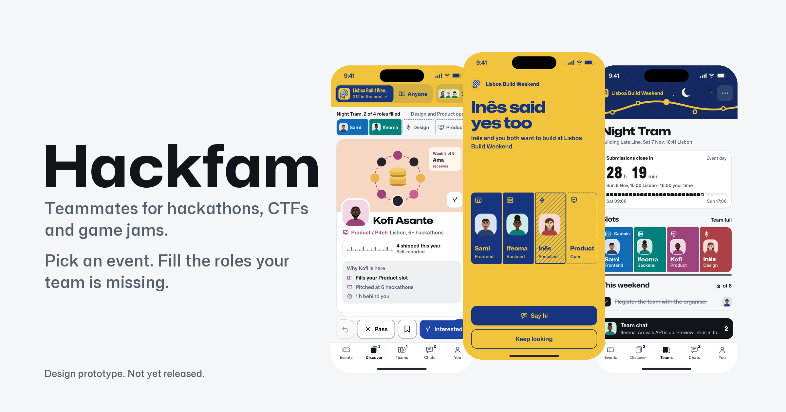
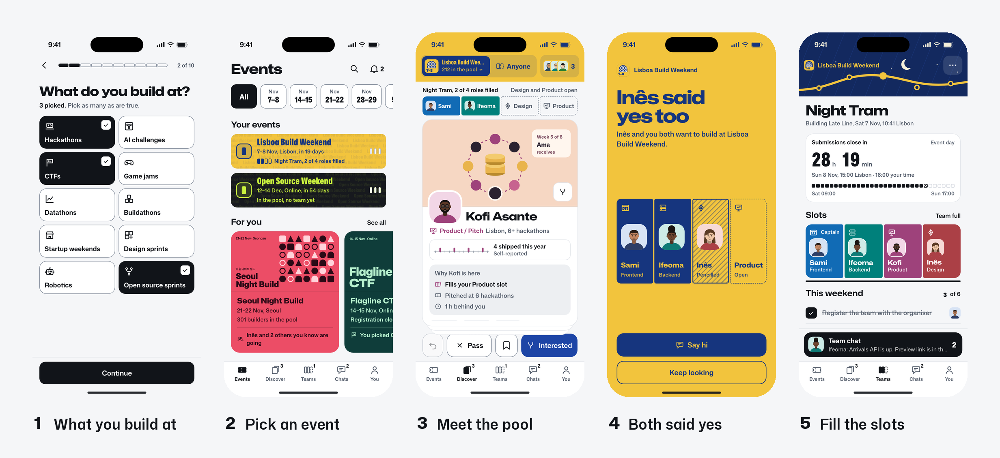
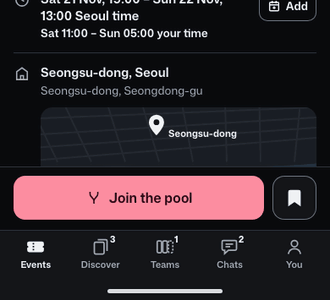
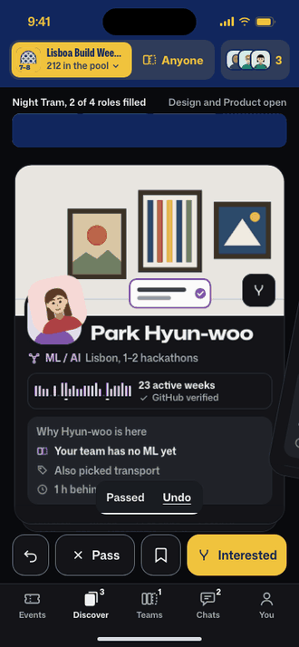
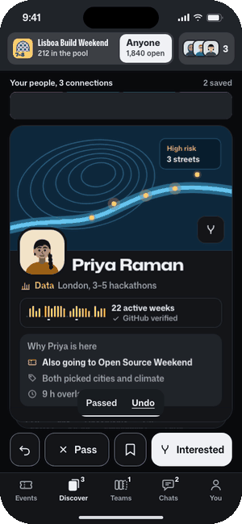
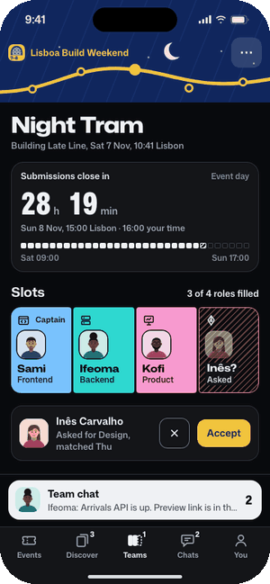
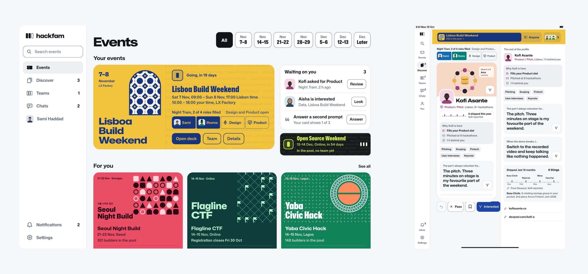
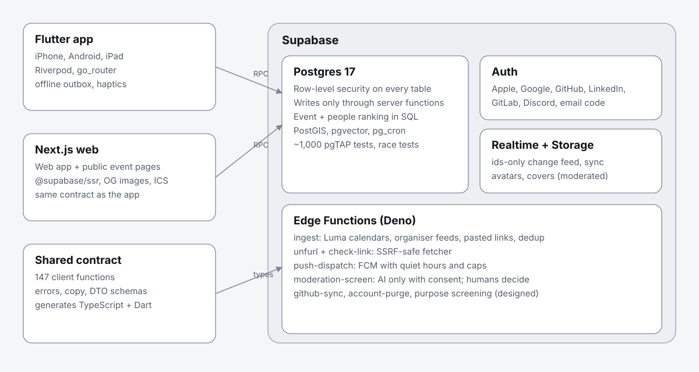

<picture>
  <source srcset="assets/composed/hero-dark.png" media="(prefers-color-scheme: dark)">
  
</picture>

**Teammates for hackathons, CTFs and game jams.** Pick an upcoming event, meet the builders going to it ranked by how well they fill your team's missing roles, and keep the people you build well with.

[Try the clickable prototype](https://yeegz.github.io/hackfam-showcase/prototype/) · [How it works](#how-it-works) · [Engineering](#engineering) · [Honest status](#honest-status)

---

## The problem

Most people arrive at a hackathon alone. Teams still form through one-shot "team-up" emails, a Discord `#find-a-team` channel and WhatsApp groups, and a 36-hour build lives or dies on whether the team has a designer, a backend person and someone who can pitch. Swipe apps for builders have been tried many times and stall for the same reasons: a city-wide deck is empty on a Tuesday, a pair still needs two more people, and "networking" gives nobody a reason to reply this week.

Hackfam is built around those failures: **event first** (everyone you see is going to the same weekend), **teams, not pairs** (role slots you fill), **complementary, not similar** (ranking favours the role you are missing), and **not a dating app by design**.

## How it works

<picture>
  <source srcset="assets/composed/how-it-works-dark.png" media="(prefers-color-scheme: dark)">
  
</picture>

## Four moments, nothing else moves

| Join the pool | Both said yes | A future teammate | The last seat |
|:---:|:---:|:---:|:---:|
|  |  |  |  |
| The wristband snaps shut | She lands in your open slot | Your build rhythms interlock | Four of four roles filled |

## One system, every screen size

<picture>
  <source srcset="assets/composed/devices-dark.png" media="(prefers-color-scheme: dark)">
  
</picture>

The team slot is the signature object: a filled slot is a person in a role, an outlined one is the role still open. Every event's poster colour tints its own pool. Status is written as words ("Registration closes Fri 3 Nov", "3 of 4 roles filled"), never as coloured dots. Phone gets a tab bar, iPad a rail, desktop a sidebar; light mode is a cool off-white and dark mode a deep near-black. One typeface (Mona Sans) uses its width axis for everything from countdown digits to poster titles.

## Engineering

<picture>
  <source srcset="assets/diagrams/architecture-dark.svg" media="(prefers-color-scheme: dark)">
  
</picture>

- **Contract first.** One versioned API contract (147 client functions, one error catalogue, explicit response shapes, forced update and kill switches) generates the TypeScript and Dart types both apps use.
- **Security in the database.** Row-level security on every table; every write goes through a server function that checks identity, blocks, deadlines and eligibility. Blocks are absolute in both directions, everywhere.
- **About 1,000 database tests.** pgTAP suites cover permissions, matching, chats, teams, notifications and ingestion; real-Postgres race tests prove two people liking each other at once make exactly one match, and two people taking the last slot leave capacity intact.
- **Tests that can fail.** 117 deliberate mutations each break one rule and must turn its named test red.
- **Safe ingestion.** Events come only from sources that allow it (official Luma calendar feeds, organiser feeds, pasted links), through an RFC 5545 parser and an SSRF-safe fetcher that refuses private, loopback and metadata addresses; 186 Edge Function tests.
- **Honest algorithms.** People and events are ranked by explainable scores; every card says why it is there, scores never leave the server, and small pools never reveal who is in them.

Read more: [Matching people](writing/01-matching.md) · [Recommending events](writing/02-event-recommendation.md)

**Stack.** Flutter (iOS, Android, iPad) · Next.js 16 + React 19 · Supabase: Postgres 17 + PostGIS + pgvector, Realtime, Storage, Edge Functions (Deno), pg_cron.

## Honest status

_Updated 21 Oct 2026._ Hackfam is **in active development and not released.**

- **Built and tested:** the backend core and most of contract v1.1, the shared contract package, and the design system in both apps (components, adaptive shells, the four moments).
- **In progress:** the last backend units (team, safety and admin reads, the future-teammate scope, event ranking) and the feature screens of both apps.
- **Not yet:** deployment, store builds, real users. The screens above come from the interactive design prototype, not the shipped app; this page will say so until that changes.

---

Built by **Yousof Selim** · [GitHub](https://github.com/yeegz) · [yousofselim.com](https://yousofselim.com)
