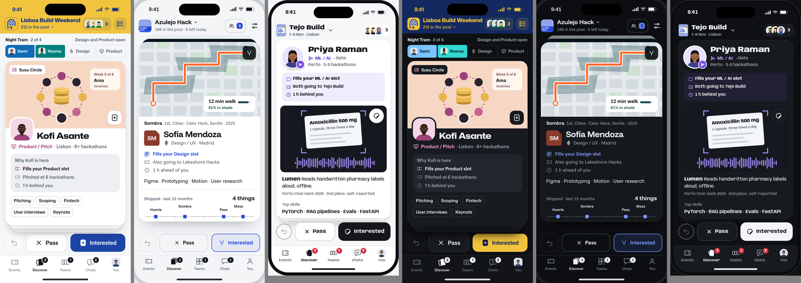
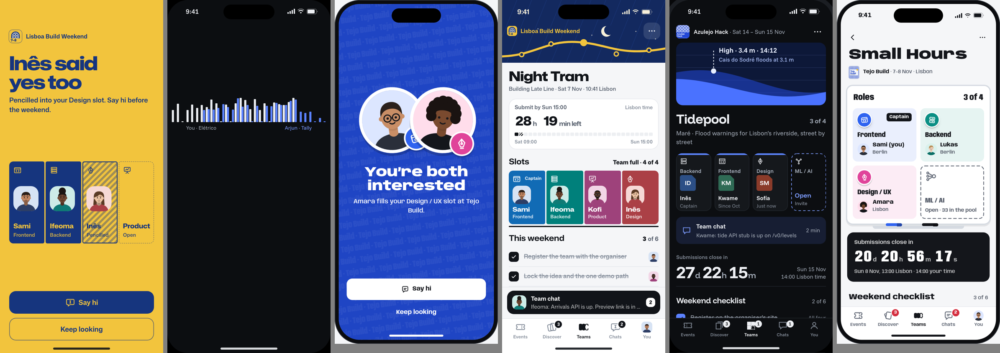

# Hackfam

**Find the people for your next build.**

An event-first teammate app for hackathons, CTFs, game jams and other builder events.

[The idea](#the-idea) · [How it works](#how-it-works) · [Design](#design) · [Engineering](#engineering) · [Honest status](#honest-status) · [Deep dives](#deep-dives)

---

This is the public showcase. The build repository is private; this one explains what the product is, how it is designed and built, and exactly how far along it is. Numbers here are read from the code, the database catalogue or a test run, and the status section says plainly what does not exist yet. Hackfam: hack + fam, the people you build with and keep.

## The idea

Team formation at hackathons still happens through one-shot "team-up request" emails, a Discord `#find-a-team` channel and WhatsApp groups. Most participants arrive solo, and a 36-hour build lives or dies on whether the team has the roles it needs: a designer, someone for the backend, someone who can pitch.

Swipe apps for builders have been tried many times. They stall for the same three reasons: a city-wide swipe deck is empty on a Tuesday afternoon, two people matching still leaves a team two people short, and generic "networking" gives nobody a reason to act now. Hackfam is built around those failures:

- **Event first, not radius first.** You join the pool for a specific upcoming event, so everyone you see has the same weekend in mind and a reason to reply this week.
- **Teams, not just pairs.** A match can be person to person or person to team. Teams have role slots; the product's visual signature is a filled slot (a person in a role) next to an outlined one (the role still open).
- **Complementary, not similar.** Ranking favours people who fill the roles your team is missing, and every card says why it is in front of you.
- **Not a dating app, by design.** No gender or relationship fields, cards lead with work rather than faces, onboarding asks what you build at, and a layered defence (rules, semantic scoring, behaviour signals and an escalation ladder) keeps romantic use out.
- **Somewhere to come back to.** An "Anyone" scope lets you find people to build with at future events, and mutual interest becomes a lasting connection rather than a match that expires.

## How it works

1. **Pick an event.** Events are ingested from sources that permit it (official Luma calendar feeds, organiser submissions, pasted links) and ranked for you.
2. **Show your work.** Role, top skills, one prompt answer, and connected proof: GitHub, LinkedIn, Devpost, CTFtime, a portfolio. A private profile-strength meter shows the next useful thing to add and disappears when there is nothing left.
3. **Meet the pool.** Swipe or browse builders and teams going to the same event. Pass, Interested (optionally replying to a specific prompt or project), or save for later.
4. **Match, talk, form a team.** Mutual interest opens a conversation. A conversation can become a team with open role slots; others request a slot or get invited, and the captain decides.
5. **Run the weekend, keep the crew.** Event-day mode puts the team, its checklist, deadline and chat first. Afterwards: "Team again?", kudos from teammates, and a "Built at" entry on your profile.

## Design

Three directions were rendered as interactive phone prototypes (real drag physics on the card deck, the match moment, filling a team slot) and compared side by side before any app screen was built. The final system combines their strengths: direction A's team-slot motif and poster-coloured event pools, B's proof-of-work strip and project-cover cards, and C's weekend date chips, wristband and role stickers.

Rules the design follows, and the product enforces in review:

- Every screen works on phone, iPad and desktop, in light and dark, in both the Flutter app and the web app.
- Status is written as words in context ("Registration closes Fri 3 Nov", "3 of 4 roles filled"), never as coloured dots or pills.
- Copy is short: a name, a verb, a time. No slogans, no helper sentence under every heading.
- Motion is spent on four signature moments (your card going live, the match, a slot filling, the deadline countdown) and nowhere else, with full reduced-motion support.

## Engineering

**Stack.** Flutter (iOS, Android, iPad) · Next.js 16 with React 19 (web and public event pages) · Supabase: Postgres 17 with PostGIS and pgvector, row-level security, Realtime, Storage, Edge Functions on Deno, pg_cron.

**Built and verified so far (local stack):**

- **Database.** 15 migrations; **307 of 307** pgTAP tests pass. Every client write goes through a server function that checks identity, blocks, deadlines, eligibility and input bounds; clients never assign their own privileges.
- **Race safety.** Real-Postgres concurrency tests prove that two people liking each other at the same instant create exactly one match and one conversation, a retried message is stored once, and two people taking the last team slot at once leave capacity intact.
- **Privacy regressions that can fail.** Fixes are proven by restoring the broken behaviour and watching the test go red, for example realtime events that ignored a block.
- **Event ingestion.** An RFC 5545 calendar parser (folded lines, time zones, multi-day events), multilingual relevance filtering, deduplication, and an SSRF-safe link fetcher that refuses private, loopback and metadata addresses including redirect and DNS tricks. **123** Deno tests pass, with real calendar samples as fixtures.
- **Services.** Push notification dispatch (honest "not configured" state when credentials are absent), GitHub proof sync, a moderation pre-screen that only uses an AI model with the person's consent, and account purge.
- **Contract first.** A versioned API contract (147 client functions, one error catalogue, explicit response shapes, forced-update and kill switches) and a feature ledger that lists every researched feature as shipped, later or cut, with a reason.

## Honest status

Hackfam is **in active development and not yet released.** Today:

- The backend core above runs and is tested locally. Version 1.1 of the contract (people and event ranking, the Anyone scope, read side, notifications) is being implemented now.
- The Flutter and web apps have their foundations (data layer, routing, auth) but not their final screens; the final visual system is being built from the prototypes shown above.
- Nothing is deployed, there is no store build, and no real person has used it yet. This page will say so until that changes, with links.

## Deep dives

- [Matching people for a team](docs/01-matching.md): reciprocal, role-first ranking without desirability scores.
- [Recommending events](docs/02-event-recommendation.md): an explainable ranking that does not starve small or new events.

---

Built by **Yousof Selim** · [GitHub](https://github.com/yeegz) · [Portfolio](https://yousofselim.com)
